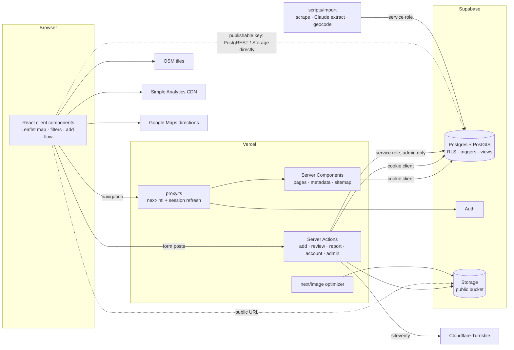

# Architecture review — 2026-10-14

**Scope:** the whole app at `a4a26cd` (Next.js 16.2 App Router on Vercel, Supabase Postgres/PostGIS/Auth/Storage, next-intl, Leaflet), the migrations, the import scripts and the deploy process.
**Method:** read the code, the migrations and the bundled Next.js 16 docs. Nothing was run against production. Requirement IDs refer to [../requirements/](../requirements/); `BL-*` to [../backlog.md](../backlog.md).
**Earlier review:** its critical/high findings #1–#4 (self-promotion to admin, writable `flagged`/`helpful_count`, photo rows surviving account deletion) are fixed in `20260529120000_security_hardening.sql` and are not repeated here.

## Verdict

**The architecture fits an alpha with a bounded dataset, and it can carry a public launch once the trust-boundary gaps below are closed.** The stack is coherent and the fundamentals are right: RLS on every table, column-level grants, admin operations behind a server-side check, real self-service GDPR features, and Slovenian-first i18n with full key parity.

Every high-severity finding comes from one pattern. **Supabase's API is public, but several rules only exist in Server Actions.** Anyone holding the publishable key (every visitor has it) can call PostgREST and Storage directly and skip the app. These rules must live in the database:
- only verified users upload photos
- users can't vote their own review helpful
- photo rows point only at the uploader's own files
- reports from throwaway accounts can't hide content

The other high-severity risk is the photo pipeline, the area [gdpr.md](../requirements/gdpr.md) calls the app's biggest risk.

## System overview

The dotted edges are the point of this review: **anything the app can do with the publishable key, a script can do too.**

## What's working well (keep doing this)

- **Database-first authorization for core rules.** RLS on all 7 tables; `flagged`, `helpful_count` and `is_admin` are not writable by clients; `SECURITY DEFINER` functions pin `search_path`; `private.is_admin()` is out of the exposed schema; default `EXECUTE` is revoked.
- **Admin is enforced where it matters.** `getAdminActionContext()` re-checks the role inside each Server Action before handing out the service-role client. It doesn't trust the page guard.
- **Server Actions validate before writing.** Photos are checked before the playground row is inserted, and a failed upload rolls back.
- **GDPR is real, not a checkbox.** Consent is versioned in metadata; account deletion removes storage files and cascades through foreign keys; export covers every table.
- **Small, safe details.** The auth callback rejects `//evil.com` redirects; password reset doesn't reveal which emails exist; `sitemap.ts` already uses a cookie-less anon client (the pattern [ADR-0001](../adr/0001-map-data-loading.md) builds on).
- **Right-sized technology.** Client-side filtering and clustering over the full set is correct for ~1.5–5k playgrounds (see ADR-0001). There are no premature services, queues or microservices.

## Findings

Severity: **High** = privacy or abuse risk exploitable today · **Medium** = will hurt at launch or scale · **Low** = hygiene.

| # | Sev | Area | Finding | Recommendation | Backlog |
|---|---|---|---|---|---|
| 1 | High | Privacy | **Flagged photos stay public.** The `playground-photos` bucket is public, so a photo reported as a privacy violation (a child's face) stays downloadable by URL after it is flagged. Deleting the file doesn't fully fix it either: `next/image` caches optimized variants for at least 4 hours (Next 16 default `minimumCacheTTL`), and the docs state there is no way to invalidate that cache. | Make the bucket private and serve photos through short-lived signed URLs, generated server-side only for non-flagged rows. Then either set `images.unoptimized` for these URLs or use Supabase image transforms, so derived copies don't outlive moderation. | BL-03 |
| 2 | High | Privacy | **GPS metadata can leak.** EXIF stripping happens only in the browser, and the original file is uploaded unchanged in three cases (small file, re-encode came out larger, resize threw). A playground photo with GPS reveals where a family was standing, and direct Storage uploads skip the browser step entirely. | Always re-encode in the browser. In the Server Action, which already gets the `File`, reject JPEGs that still contain an EXIF APP1 segment. Long term, move uploads behind the action (#3) so the server sees every byte. | BL-02 |
| 3 | High | Trust boundary | **Photo uploads skip the app's rules.** The verified-email requirement exists only in `createPlaygroundAction`. The `photos` insert policy and the Storage insert policy only check `auth.uid()`, and `photos.storage_path` is free text, so a user can insert a photo row pointing at **any** object, including someone else's or a flagged one. | Add `email_confirmed_at is not null` (via a `private.is_verified()` helper) to both insert policies, and `storage_path like auth.uid()::text || '/%'` to the `photos` policy. | BL-01, BL-36 |
| 4 | High | Abuse | **Moderation can be used to censor.** Three reports from any three accounts hide a playground. Accounts need no verified email to report, and reports have no Turnstile, so a competitor or troll can take down any listing in minutes. | Count only reports from verified accounts that are older than N days toward auto-flagging. Send admins a notification on auto-flag. Consider "hide pending review" only for `privacy_violation`, and leave other reasons visible until an admin acts. | BL-10 |
| 5 | Medium-High | Delivery | **Schema and code deploy separately, unchecked.** Vercel deploys every push to `master`; migrations are applied to prod by hand through MCP. Nothing checks that prod's schema matches what the deployed code expects. Preview deployments have no Supabase env vars (they're Production-scoped), so there is no staging. | (a) Write migrations expand-then-contract, so code and schema can ship in either order. (b) Add a CI step that fails when the repo has migrations prod doesn't (`supabase migration list --linked` with an access token in GitHub secrets). (c) Later: Supabase branching or a staging project wired to Preview. | BL-38 |
| 6 | Medium | Security | **Turnstile fails open** when the secret is missing in production (only a warning). Review, report and login have no bot protection, and there are no server-side rate limits. | Fail closed when the site key is set without a secret. Add per-user and per-IP limits (Postgres function or Upstash) on signup, add, review and report. | BL-05, BL-19 |
| 7 | Medium | Performance | **Every Home and Map view reads the whole table.** Each one runs a full `playgrounds` scan plus a whole-table `reviews` aggregate through a cookie-bound client, so nothing can be cached. Admins also see flagged rows on the public map. | Implement ADR-0001: a shared cached snapshot, slimmed, invalidated by tag, with a payload budget test. | BL-07 |
| 8 | Medium | Performance | **Two or more Auth round trips per signed-in page.** `proxy.ts` calls `auth.getUser()` (a network call to Supabase Auth) on every matched request, then pages and actions call `getUser()` again. | Use `auth.getClaims()` (local JWT verification with asymmetric signing keys; available in auth-js 2.103) in the proxy and read-only pages. Keep `getUser()` where the freshest record matters: photo upload (`email_confirmed_at`), admin, account deletion. Check that the project has asymmetric signing keys enabled first. | BL-35 |
| 9 | Medium | GDPR | **Users can't see their own flagged content.** `select … using (flagged = false)` applies to owners too, so the user's own flagged rows are missing from "Export my data" (a right-of-access gap) and from any future "my contributions" view. | Add owner policies: `using (flagged = false or user_id = (select auth.uid()))` on playgrounds, reviews and photos. The UI then shows a "under review" badge. Keep public views filtering `flagged = false` explicitly. | BL-04, BL-16 |
| 10 | Medium | GDPR | **Usernames leak email addresses.** The username is the email local part (`janez.novak`), and `profiles` is world-readable. That often reveals a real name and half an email address. | Generate a neutral handle on signup (e.g. adjective+animal+number) and let the user change it. Offer existing users a rename. | BL-20 |
| 11 | Medium | Security | **Third-party script without a CSP.** No `Content-Security-Policy`, while an unpinned third-party script (`simpleanalyticscdn.com/latest.js`) runs on every page, including login and signup. "latest" also rules out Subresource Integrity. | Add a nonce-based CSP (Supabase, Turnstile, OSM tiles, analytics). Pin or self-proxy the analytics script. | BL-21 |
| 12 | Medium | Operations | **No error tracking.** Server Action failures go to `console.error` only. Vercel log retention on lower plans is short, so production failures go unnoticed. | Add Sentry (or similar) for server and client errors, and alert on Server Action error rates. | BL-32 |
| 13 | Medium | Capacity | **Plan limits are unchecked.** At about 300–500 KB per photo, up to 8 per playground, Supabase Storage grows quickly. If the project is on the Free plan, the storage quota and inactivity pausing will hit a live alpha first. `next/image` optimization of every photo variant also counts against Vercel image quotas. | Check the Supabase and Vercel plan limits against "3,000 playgrounds × ~3 photos" before public launch. Decide on Supabase transforms vs `next/image` together with #1. | BL-33 |
| 14 | Low | Data model | **Equipment is free text.** `equipment` is a jsonb array of strings with no vocabulary, which is why it can't be translated or filtered. | Constrain it to a known list (check constraint or lookup table) and translate via i18n keys before building the filter. | BL-18 |
| 15 | Low | Hygiene | **The service-role client has no build-time guard.** `supabase/admin.ts` (service-role) and `supabase/server.ts` don't `import "server-only"`. The secret isn't `NEXT_PUBLIC_`, so it wouldn't leak, but an accidental client import would fail only at runtime. | Add `import "server-only"` to both files. | BL-40 |
| 16 | Low | Hygiene | **Import scripts need tidying.** Their dependencies (`@anthropic-ai/sdk`, `cheerio`, `dotenv`) sit in `dependencies`. The scraper's User-Agent points to `github.com/anthropics` instead of this project. Extraction is pinned to `claude-opus-4-7`, a previous-generation model. | Move script-only packages to `devDependencies`. Use a UA with this project's URL and contact. Re-evaluate the model against the current Claude 5 family; a smaller model is likely enough for structured extraction. | BL-41 |
| 17 | Low | Platform | **Node versions disagree.** Local Node is 20 (end of life), `package.json` has no `engines`, and CI now uses 22. | Pin `engines.node` and an `.nvmrc` to one LTS, and set the same version in Vercel. | BL-09 |
| 18 | Low | Testing | **e2e isn't in CI.** It now exists (`tests/e2e`) but CI doesn't run it, and nothing has run the DB/e2e suites yet. | Run them locally once Docker is up, then add an e2e job (local Supabase + `next build`). | BL-08 |

## Recommended order

1. **Close the trust boundary (about 2–3 days).** #3, #4, #9, plus the "no self-vote" rule (BL-11). These are all migrations plus pgTAP tests. Two of them, verified-email uploads and no self-vote, already have `todo` assertions in `supabase/tests/10_access.test.sql` that will flip to passing.
2. **Photo pipeline (about 3 days).** #1 and #2 together: a private bucket, signed URLs, server-side EXIF check, and the image optimization decision. This is the highest-stakes GDPR work.
3. **Fail closed and observe (about 2 days).** #6 (Turnstile), #12 (error tracking), #5a/b (migration check in CI).
4. **Performance (about 2–3 days).** #7 (ADR-0001) and #8 (`getClaims`).
5. **Before public launch.** #10, #11, #13, and the remaining Low items.

## Addendum — 2026-10-15, after running the test suites

The DB and e2e suites now run against the local stack (`pnpm test:db`: 37 pass; `pnpm test:e2e`: 28 pass, 7 known gaps skipped). The pgTAP `todo` assertions **confirm** these findings against a real database, not just from reading code:

| Finding | Confirmed by |
|---|---|
| #1 bucket is public | `[FR-COM-06]` bucket `public = true` |
| #3 unverified users can insert photo rows | `[FR-ADD-04]` insert succeeds for an unverified user |
| #10 username = email local part | `[GDPR-04]` `owner@example.com` → username `owner` |
| BL-11 self-votes allowed | `[FR-COM-03]` voting your own review succeeds |

The e2e run also surfaced three new low-severity items: the cookie notice covers the map controls at 375 px (BL-42); logout signs the user out on every device (BL-43); missing pages return HTTP 200 instead of 404 (BL-44).

**#5 (deploy coupling)** is now partly addressed by the [ops handoff](../../ops/README.md). Migrations reach production only through tickets that Cursor applies via MCP **before** pushing code; checksums guarantee the applied SQL is what was tested locally; every Cursor run starts with a drift check. **#18 (e2e in CI)** is addressed: CI now has an `e2e` job, green on its first GitHub run (2026-10-16).

## Addendum — 2026-10-16, photo pipeline

**Correction to #1.** The finding said `next/image` caches optimized photo copies for ≥ 4 hours. That was wrong for this code: photos are rendered with a plain ``, so no optimizer copies exist. The core of #1 (flagged and deleted photos stay public by URL) was right.

Working on #1 and #2 ([ADR-0002](../adr/0002-photo-pipeline.md)) turned up two more problems, both now fixed in ops 0003:

- **Multi-photo submissions failed.** Server Actions accept 1 MB by default, and the add flow sends every photo in one request. Four normal photos (~1.4 MB) failed with `Body exceeded 1 MB limit`. Reproduced in e2e. This explains why production had no photos.
- **"Deleted" photos stayed public.** Admin delete removed photo rows but not the files.

Status: #1 and #2 are addressed by ops 0003 (expand: server-validated uploads, signed URLs) and ops 0004 (contract: private bucket, no client writes).

## Revisit this review when

- the dataset passes 5,000 playgrounds or the map snapshot passes 1 MB (ADR-0001's triggers), or
- user-generated photos exceed ~5,000, or
- a second maintainer joins (the deploy coupling in #5 gets riskier with more hands), or
- offline/PWA work starts (it changes how map data and photos are cached).
